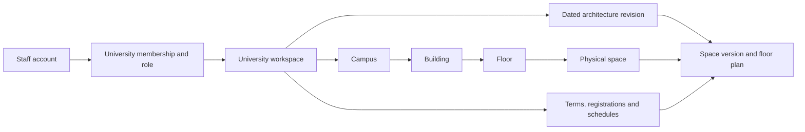

# University-owned building models and registration-driven scheduling

> Historical architecture and pilot: the [current specification](../docs/SPECIFICATION.md) and [editing contract](../docs/EDITING.md) take precedence. Multi-university accounts, publication and extra student-input schemas below are outside the agreed standalone scope.

**Updated:** 22 October 2026. This extends the Tanta FCI project to reusable university profiles, versioned physical architecture, and student-record-based scheduling. All first/second/summer-term teaching and examination requirements remain in scope.

## 1. Product model

Each university has an institutional workspace. Staff accounts become members of that workspace with roles; the buildings and schedules belong to the institution rather than to one professor's personal account. One account may have authorized membership in several institutions.



The hierarchy is configurable for every university. Room names, buildings, floors, capacities, equipment, operating hours, and routing data are institutional data. Adding another lab, changing a room's purpose, or opening another building should not require rewriting the scheduler.

The current repository contains the local relational/storage foundation and solver pilot. It does not contain a hosted account service, login screen, floor-plan editor, or production authorization system.

## 2. Architectural input and ownership

Support three levels of architectural input:

1. A structured campus/building/floor/room list. This is enough to start a usable inventory without a drawing.
2. A PDF/image floor plan with staff-confirmed room outlines, labels, door connections, stairs, lifts, and paths. Preserve the original asset and its checksum.
3. Optionally, a later CAD/IFC adapter supplying equivalent geometry and relationships. Full BIM processing is not a prerequisite for the graduation project.

Represent room outlines using a declared coordinate system and units, attached to a particular floor-plan revision. Geometry with no scale must not be used to invent walking distances. Travel times can instead come from measured or staff-approved path weights.

Physical hierarchy and administrative ownership are separate relationships. A faculty can use rooms in a shared central building; this does not make that building a child of the faculty. The university owns the common resource catalogue, with booking access managed for its faculties and departments.

## 3. What was actually extracted for Tanta

The scan downloaded **73 distinct linked timetable PDFs**, processed **137 pages**, and used Arabic/English OCR on **28 image pages**. It produced **648 location-label observations**, grouped into **20 provisional labels**: 19 physical-location labels and one online marker. The location observations themselves came from embedded PDF text; OCR pages in this scan did not add matching room observations.

Observed labels include numbered lecture halls 1–3, numbered laboratories 1–2, central upper/lower hall labels, explicit laboratory C–H labels, bare C–H labels, and online delivery. Bare C and “lab C” remain different candidate groups until their identity is confirmed. The 19 physical labels are **not a count of 19 distinct rooms**.

See the [review report](PDF-SPACE-REGISTRY.md), [CSV](../data/public/space_registry.csv), and [detailed JSON](../data/public/space_candidates.json). Each observation retains its source document, PDF page, extraction method, and normalized bounding box. The [source index](../data/public/source_documents.json) retains URLs and content hashes.

Buildings, floors, dimensions, routes, usable equipment, approved exam capacities, and opening hours were not established by the timetable scan. Those fields remain unknown. The upper/lower wording of a hall label does not establish a numbered architectural floor.

The separately transcribed [published inventory claims](../data/public/published_inventory_claims.json) preserve the student-guide figures without applying them as current operational capacities or silently assigning them to aliases. They also record lab B, which was not found as a location label in this timetable scan. [Official teaching page](https://ci.tanta.edu.eg/stu_study_tables.aspx), [official exam page](https://ci.tanta.edu.eg/stu-exam-tables.aspx), [faculty-linked guide](https://ci.tanta.edu.eg/files/%D8%AF%D9%84%D9%8A%D9%84%20%D8%A7%D9%84%D8%B7%D8%A7%D9%84%D8%A8%2026.pdf).

All imported Tanta candidates are saved under a local draft `tanta-university` profile and remain unapproved for scheduling. No real building or student enrolment data was fabricated to fill the gaps.

## 4. Stable identities and effective architecture revisions

| Data object | Meaning |
|---|---|
| `University` | Institutional owner, timezone, profile state. |
| `Account` and `UniversityMembership` | External identity reference and role within an institution. |
| `Campus`, `Building`, `Floor` | Physical hierarchy with stable identifiers. |
| `ArchitectureRevision` | Effective date, approval state, and reason for a configuration change. |
| `FloorPlan` | Original drawing asset, checksum, coordinate system, units, and revision. |
| `Space` | Stable physical identity, independent of its displayed label. |
| `SpaceVersion` | Name, type, floor, capacities, features, geometry, and open/closed state for one revision. |
| `SpaceAlias` | A label mapped to a confirmed space within a context such as a building or source system. |
| `SpaceLineage` | A recorded split, merge, or replacement between old and new space identities. |
| `PhysicalResourceAtom` | The indivisible physical portion occupied by a room or room combination. |
| `NavigationNode` and `NavigationEdge` | Doors, rooms, corridors, stairs/lifts, paths, and travel weights for a revision/profile. |

For a name change or a capacity update, append a space version under a new architecture revision. Query the latest approved version effective at the event date. Old schedule assignments retain their original version references.

For a permanent split, retire the old space effective on the change date, create the new space identities, and link them through lineage. For a merge, retire the predecessor spaces and create the merged successor. The original published timetable remains reproducible.

Movable partitions require additional care. Suppose a combined hall occupies atoms `{left, right}`, while two smaller rooms occupy `{left}` and `{right}`. Simultaneous bookings are valid only when their occupied atom sets are disjoint. The system cannot book the combined hall at the same time as one of its subdivisions, or count both as separate capacity for the same exam.

The [reference SQL schema](../timetabling/schema.sql) uses university-scoped keys and foreign keys. Approved architecture revisions and space-version rows cannot be overwritten through updates. Source-document versions are content-addressed, so a changed PDF at the same URL does not erase the earlier evidence.

## 5. Location slots and availability

Do not permanently hardcode one-hour cells as the architecture. Store dated opening intervals, closures, and reservations; derive candidate starts for the duration of the activity being scheduled.

```text
usable room intervals
  = approved opening intervals
    intersect effective space lifetime
    intersect requested scheduling horizon
    minus closures, maintenance and existing bookings

candidate start
  = an allowed calendar/grid start for which the whole activity,
    preparation and cleanup fit inside a usable interval
```

A 30-minute oral appointment, a two-hour lecture, and a practical exam with reset time need different candidate placements in the same room. A room can have time slots but still be ineligible because its type, equipment, accessible route, or capacity is unsuitable.

Maintain separate seated, examination, and usable-workstation capacities. Unknown capacity is not zero and is not assumed sufficient; an operational decision is needed before using it. An installed-computer inventory count is distinct from the number of currently working machines.

Use the institution's timezone when creating wall-clock calendars and persist unambiguous instants for the solver. For Tanta the profile is `Africa/Cairo`; resolve timezone and daylight-saving transitions when expanding term dates. Odd/even teaching-week patterns refer to the institution's academic week numbering, not automatically to ISO calendar-week parity.

**A blank PDF cell does not establish free availability.** It may omit another department's booking, maintenance, or other activities. Existing schedules can supply occupancy evidence after reviewed event extraction, while opening hours and completeness of bookings require their own sources. The current scanner extracts location labels, not an authoritative booking calendar.

The executable interval algorithm is in [availability.py](../timetabling/availability.py).

## 6. Student records and participation

The schedule optimizer needs relationships rather than names or national identity numbers. Use pseudonymous keys consistently within the institution.

| Import | Required fields |
|---|---|
| Active enrolments | `university_id`, `student_key`, `offering_id` |
| Teaching-component allocations | `university_id`, `student_key`, `offering_id`, `component`, `section_key` |
| Assessment sitting allocations | `university_id`, `student_key`, `assessment_id`, `event_id` |

The [CSV templates](../data/templates/) define these contracts. The source-system export should establish its snapshot date and which active registrations are included. Registration additions, withdrawals, exemptions, and changes need an updated snapshot and validation.

Course offerings, dated teaching occurrences, and assessments are separately configured. Each required component must have an explicit section assignment. A student assigned to lab section A does not attend every alternative lab section. Multiple dated occurrences of the assigned section all inherit the membership.

Each required assessment component has its own assessment ID. A practical assessment with several authorized batches requires exactly one eligible sitting per candidate. A course with written, practical, and oral components requires participation in each applicable component, rather than treating them as alternatives.

[records.py](../timetabling/records.py) checks university ownership, offering references, duplicate registrations, unknown or missing teaching-section choices, eligibility, duplicate exam sitting assignments, and missing candidate coverage. It then builds `event -> set(student_key)` membership. Students repeating or taking cross-level courses naturally connect the affected events; study-year labels are not used as a substitute for registration data.

Before registrations exist, the same application can work with declared expected cohorts, but that is a provisional planning mode. It cannot certify student-level feasibility for choices that have not been supplied.

## 7. Core algorithms

### A. Import and reconcile locations

1. Discover timetable PDF links on approved institutional index pages.
2. Record URL, source identity, content hash, and retrieval outcome.
3. Extract positioned text; apply Arabic/English OCR to pages without usable text.
4. Normalize Arabic presentation forms, visual direction, whitespace, and numeral variants while preserving labels.
5. Identify exact location labels, using the room-column position where detected.
6. Save observations with provenance; keep uncertain aliases and nonphysical delivery markers separate.
7. Have staff resolve physical identities and attach them to the campus/building/floor model before scheduling approval.

The scanner deliberately retains the distinction between `مدرج 1`, `معمل 1`, bare `C`, and explicit `معمل C`. Reconciliation is a data operation with an audit trail, rather than a permanent string-replacement rule embedded in the optimizer.

### B. Expand the term calendar and form events

For each offering, expand required lectures, tutorials and labs into dated occurrences, respecting teaching weeks, odd/even patterns, holidays, delivery mode, and contact-hour requirements. Create dated exam sittings or appointment requirements using the assessment profile. Perform this for first, second and summer terms using their own calendars.

Resolve the effective space and routing revisions for the relevant dates. Keep other faculties' bookings and previously committed events in the common reservation calendar. Terms can be optimized separately while still detecting actual date overlaps with other periods.

The current pilot receives already-expanded occurrences and permitted starts. The complete recurrence/calendar editor is a next application module.

### C. Construct conflict and resource indexes

Create an inverted index `student -> required event IDs`. For every student, increment the edge weight for each pair of their required events. This gives a weighted student conflict graph. Staff assignments and physical resource atoms provide additional independent indexes.

The student graph can be built in `O(sum(d_student^2))`, where `d_student` is the number of event occurrences attached to that student. Filter by relevant dates/windows for larger instances. Graph coloring is a useful initial heuristic, while the final model must also handle duration, availability, equipment, and other resources.

### D. Compute movement requirements

Use Dijkstra's algorithm over the approved traversable-path graph. Build separate travel profiles where accessible routes differ. Room polygons alone are insufficient: doors, stairs, lifts and interbuilding paths determine feasible movement.

For consecutive activities involving the same student or staff member, require enough time between the end of the first and the start of the second for the applicable route. Online transitions have an explicit policy value. Missing/unconfirmed paths must not silently become zero travel time.

The pilot blocks unconfirmed or unreachable transitions and reports the involved route pairs. A resulting infeasibility statement applies to that conservative encoded input; it is not evidence that an unmeasured building has no real path. The pilot uses one supplied navigation snapshot per solve; date-varying navigation is required when production changes affect routes within the solve horizon.

### E. Generate feasible placement domains

For each event, form eligible alternatives containing:

```text
event ID + start/end + space IDs + effective space-version IDs
         + occupied physical atoms + candidate-to-room allocation
```

Filter by opening intervals, closures, duration/buffers, approved operational capacities, room type/features, student unavailability, and staff availability.

For written exams, a placement may use several simultaneous rooms. For practical exams, use authorized candidate batches and equipment requirements. For oral assessments, use explicit appointments or authorized groups and their panels. Staff role eligibility, automatic panel/invigilator selection, and batching policies are part of the complete application model; the current pilot receives those assignments rather than inventing them.

The pilot supports multi-room allocations but assigns candidates deterministically within an alternative. The full implementation should optimize candidate-to-room allocation when it affects feasibility or movement. A proof of infeasibility in the pilot is limited to its encoded alternatives.

### F. Solve assignments with CP-SAT

For every permitted placement `p` of event `e`, introduce a Boolean decision `x[e,p]`.

```text
For every required event e: sum(x[e,p] for p in domain[e]) = 1

For any two incompatible placements:
    x[e,p] + x[f,q] <= 1
```

Incompatibility includes shared physical occupancy, student/staff overlaps, inadequate transitions, and mandatory exam spacing. Exclude invalid alternatives rather than trading hard violations against preferences. A production interval formulation can use optional intervals and resource `NoOverlap`/cumulative constraints to avoid materializing excessive pairwise comparisons. [OR-Tools scheduling model](https://developers.google.com/optimization/scheduling/job_shop).

The implemented finite-domain pilot is intended to validate modelling decisions on small cases. Its pairwise alternative comparisons can grow quadratically; it is not benchmarked for the whole faculty. The broader faculty constraint catalogue, recurring-pattern coupling, equipment pools, automated staff allocation, exam policies and performance work remain application implementation tasks.

### G. Repair after an architecture or registration change

Create a new input snapshot with the effective change; preserve the earlier snapshot and schedule. Remove now-invalid placements, retain authorized pins, and solve the revised problem.

The pilot prioritizes fewer moved events over time/room preferences with a bounded objective:

```text
move_weight = 1 + maximum possible total preference penalty
minimize move_weight * number_of_changed_events + preference_penalties
```

This guarantees that preference improvements cannot compensate for an additional moved event within this model. A locked event with no legal remaining placement is reported as infeasible instead of silently unlocked. Production can extend the disruption measure to affected students, appointment changes, days changed, and administrative policy priorities.

Always check coverage and recompute the relevant constraints after solving. The pilot's post-solve auditor reconstructs allowed placements and checks assignments; it shares rule helpers with the solver, so it is not a wholly separate implementation of every rule. Dedicated regression cases exercise the critical failure modes.

Treat `FEASIBLE`, `OPTIMAL`, `INFEASIBLE`, `MODEL_INVALID`, and `UNKNOWN` distinctly. An optimality proof only applies to the actual encoded domain and objective. A timeout is not proof of impossibility. General minimal infeasibility explanations are not implemented in the pilot. [CP-SAT result statuses](https://developers.google.com/optimization/cp/cp_solver).

## 8. Saving under university accounts

Every institutional object carries `university_id`, and institutional foreign keys include it. A building in one university cannot reference another university's campus, even if labels happen to match.

The account service should verify membership and role before selecting the active institution. Production database access should enforce this institution scope as well as application authorization. PostgreSQL row-level security is an appropriate additional enforcement layer; database owners and privileged roles require deliberate treatment. The SQLite reference database proves relational scoping, not production user authorization. [PostgreSQL row security](https://www.postgresql.org/docs/current/ddl-rowsecurity.html).

Save floor-plan assets, inventory revisions, import evidence, enrolment snapshot references, solver settings, and published schedule versions within the university's workspace. A solver run must point to its exact input snapshot and space versions. Uploads must remain drafts until the operational data needed for scheduling is confirmed.

The present local database has a draft Tanta profile and PDF observations. It contains no real staff account credentials and no real student registration dataset. No external university account was created.

## 9. Implemented foundation and remaining inputs

Implemented here:

- Reproducible PDF discovery, text extraction, image-page OCR and source provenance.
- Reviewable Tanta space labels, CSV export and local university-scoped registry storage.
- Relational architecture revisions, floor-plan references, room history, splits/merges, physical atoms, and navigation structures.
- Student CSV contracts, participation derivation, weighted conflict graph, availability interval processing and shortest paths.
- A CP-SAT pilot for supplied dated activities and capacities, participant conflicts, movement, exam gaps, locked assignments and schedule repair.
- A synthetic demonstration spanning term labels for first, second and summer, with lecture/lab, midterm, written, practical-batch and oral events.
- Regression tests for the above data boundaries and failure cases.

Needed to populate and evaluate the real Tanta model:

1. Floor plans **or** a room-to-building/floor list, with aliases and shared-hall access.
2. Current seats, approved exam places, usable computers/equipment, opening hours and closures.
3. An authorized pseudonymized registration export plus section allocations and assessment eligibility/batch information.
4. Staff roles/availability and approved academic/exam policies.
5. Complete source timetables and external commitments where PDF outputs omit bookings.

These inputs determine a real timetable. Their absence does not justify guessing geometry, treating public candidate numbers as the complete student registry, or declaring a Tanta schedule solved.

## 10. Running the foundation

On this NixOS workspace:

```sh
nix-shell
uv sync --locked
python scripts/scan_faculty_pdfs.py
python scripts/export_registry_review.py
python -m timetabling.registry
uv run python -m timetabling.demo
uv run python -m unittest discover -s tests -v
```

The scanner and local registry use the Python standard library and installed Poppler/Tesseract tools. The solver uses the pinned OR-Tools dependency in `uv.lock`. `shell.nix` provides project-scoped native runtime libraries; it does not change system configuration.

The PDF cache is ignored by Git. Keep real input records under the ignored `data/private/` directory and out of public examples. The supplied CSV rows and generated solver result are explicitly synthetic.
